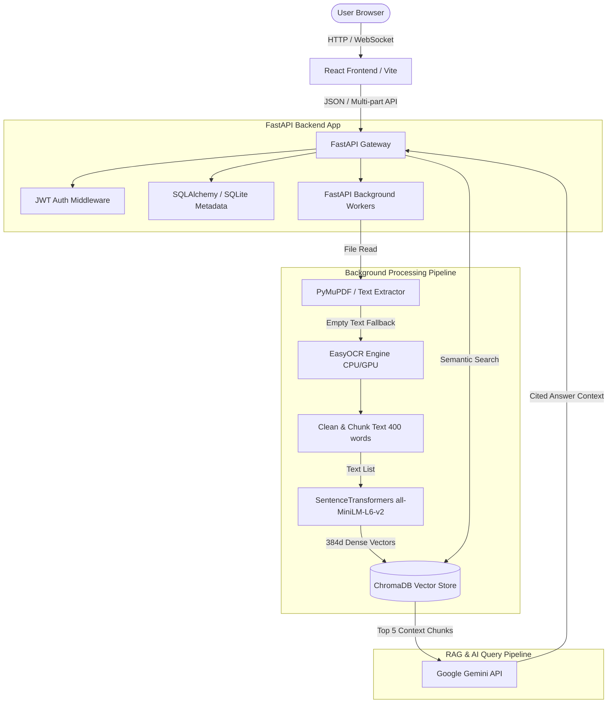

<<<<<<< HEAD
# Smart Document Intelligence Platform (DocIntel AI)

An enterprise-ready, AI-powered platform for uploading, processing, OCR-transcribing, index-storing, semantically searching, and conversing with documents. Powered by FastAPI, React, SQLite, ChromaDB, Sentence Transformers, and Google Gemini.

---

## Architecture Design



---

## Tech Stack Summary

- **Frontend**: React.js, React Router, Tailwind CSS, TanStack Query (React Query), Axios, Lucide Icons.
- **Backend**: FastAPI (Python), Uvicorn, SQLAlchemy, Pydantic.
- **AI/ML Stack**: Google Gemini API, Sentence Transformers (`all-MiniLM-L6-v2`), EasyOCR, PyMuPDF.
- **Databases**: SQLite (for relation metadata/history) and ChromaDB (vector database).
- **Orchestration**: Docker, Docker Compose.

---

## Environment Variables Configuration

Create a `.env` file in the root folder of the project based on [.env.example](.env.example):

```ini
JWT_SECRET=supersecretjwtkeyforhashingdocsplatform
JWT_ALGORITHM=HS256
ACCESS_TOKEN_EXPIRE_MINUTES=1440
SQLITE_DB_URL=sqlite:///./sql_app.db
CHROMA_PERSIST_DIR=./chroma_db
UPLOAD_DIR=./uploads
GEMINI_API_KEY=AIzaSy...   # Get this from Google AI Studio
PORT=8000
```

---

## Quick Start with Docker (Recommended)

To run the application inside Docker containers (preconfigured with SentenceTransformer and OCR caching):

1. **Pre-requisites**: Ensure Docker and Docker Compose are installed on your machine.
2. **Setup Env**: Copy the env file and populate your Gemini API Key:
   ```bash
   cp .env.example .env
   ```
3. **Boot Application**:
   ```bash
   docker-compose up --build
   ```
4. **Access Portal**:
   - Frontend UI: `http://localhost:5173`
   - Backend APIs (Swagger Docs): `http://localhost:8000/docs`

---

## Running Locally for Development

### 1. Backend Setup

1. Navigate to the backend directory:
   ```bash
   cd backend
   ```
2. Create and activate a Python virtual environment:
   ```bash
   python -m venv venv
   # Windows:
   venv\Scripts\activate
   # Linux/macOS:
   source venv/bin/activate
   ```
3. Install dependencies:
   ```bash
   pip install -r requirements.txt
   ```
4. Start the development server (with auto-reload):
   ```bash
   uvicorn app.main:app --reload --port 8000
   ```

### 2. Frontend Setup

1. Navigate to the frontend directory:
   ```bash
   cd ../frontend
   ```
2. Install npm dependencies:
   ```bash
   npm install
   ```
3. Start the Vite React development server:
   ```bash
   npm run dev
   ```
4. The server runs on `http://localhost:5173` with proxy redirection configured to forward `/api` requests to `http://localhost:8000`.

---

## API Documentation Catalog

Below are the primary exposed API routes:

| Method | Endpoint | Description | Auth Required |
| :--- | :--- | :--- | :--- |
| **POST** | `/api/auth/register` | Register a new user | No |
| **POST** | `/api/auth/login` | Login and obtain JWT access token | No |
| **POST** | `/api/auth/logout` | Client logout helper | No |
| **GET** | `/api/users/profile` | Retrieve profile metadata | Yes |
| **POST** | `/api/upload` | Upload a PDF or Image (starts background OCR/Index) | Yes |
| **GET** | `/api/documents` | Get list of user documents | Yes |
| **GET** | `/api/document/{id}` | Get specific document meta and chunks | Yes |
| **GET** | `/api/document/{id}/file` | Streams original file for preview canvas | Yes |
| **DELETE** | `/api/document/{id}` | Delete document, text chunks, and vectors | Yes |
| **POST** | `/api/chat` | Chat with single/all documents (RAG) | Yes |
| **POST** | `/api/summary` | Generate short, detailed, and bullet summaries | Yes |
| **POST** | `/api/document/{id}/extract-info` | Extract structural templates (Invoice/Resume/Contract) | Yes |
| **POST** | `/api/semantic-search` | Perform meaning-based vector searches | Yes |
| **POST** | `/api/keyword-search` | Perform keyword SQLite searches | Yes |
| **GET** | `/api/dashboard` | Fetch aggregated counts and recent logs | Yes |
| **GET** | `/api/chat-history` | Fetch previous RAG chat sessions | Yes |
| **GET** | `/api/export/chat/{id}/pdf` | Export AI answers as PDF downloads | Yes |
| **POST** | `/api/export/summary/{id}/docx` | Export summaries as DOCX downloads | Yes |

---

## Production Configurations

For production deployments:
1. **Change JWT Secret**: Replace the `JWT_SECRET` with a cryptographically secure random string.
2. **Reverse Proxy / SSL**: Bind the containers behind a Nginx reverse proxy or Cloudflare tunnel configured with SSL/TLS.
3. **CORS Restrictions**: Modify `backend/app/main.py` CORS setup from `allow_origins=["*"]` to strict target domains.
4. **Volume Backups**: Regularly back up `sql_app.db` and the `chroma_db/` directory.
=======
# Smart-document-reader
>>>>>>> 789f6227f2c026e90ff6d78fc62fb17a6427f029
